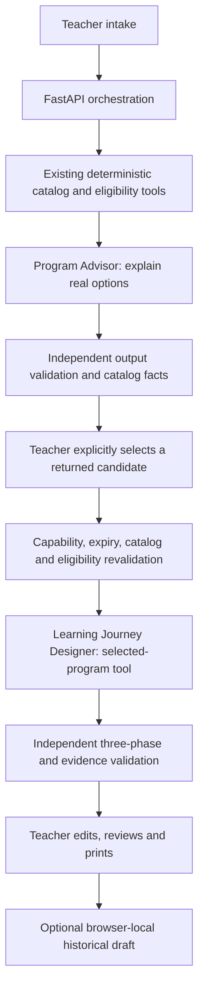

# Report-ready genuine agent trace

This document organizes existing real evidence; it is not a new browser demonstration. Primary run: [Stage 4 browser-live.json](../artifacts/stage4/browser-live.json), recorded during Stage 4 through the course gateway. Both agents reported `gpt-6-luna-2026-09-22`. No agent-to-agent delegation occurred.

## Actual successful sequence

| Step | What actually happened | Evidence |
| --- | --- | --- |
| 1. Teacher request | Grade 4, 24 students, force/motion/design goal, $400 USD assumption, 90-minute maximum | `records[0].request`; [intake screenshot](../artifacts/stage4/intake-live.png) |
| 2. Deterministic checks | Grade, fee, duration and operational uncertainty retained for all catalog programs | `records[0].response.eligibility_results`; Catapult $336 / 90 minutes |
| 3. Advisor tool | Genuine `search_matching_programs` call executes existing matching functions; tool arguments/results retained | `records[0].run_trace.tools` and `model_tool_calls` |
| 4. Recommendations | Catapult, Marble Roller Coaster, Whitney Relay; independent ID/category/source/prose validation passed | `records[0].response.recommendations`; [recommendations](../artifacts/stage4/recommendations-live.png), [comparison](../artifacts/stage4/comparison-live.png) |
| 5. Teacher choice | Browser workflow explicitly selected Catapult; no automatic agent choice | `/api/journey` request plus trace `human_selection`; [selection](../artifacts/stage4/selection-live.png) |
| 6. Revalidation | Service checks workflow capability, membership, catalog digest and current match before Designer | `backend/service.py:journey`; successful selected response and passing selection tests |
| 7. Designer tool | Genuine `get_selected_program` reads Catapult and matching evidence | `records[1].run_trace.tools` and `model_tool_calls` |
| 8. Three-phase plan | Predictions and blank observation table before; staff-directed observations during; actual evidence-based reflection/assessment after | `records[1].response.ai_teaching_suggestions`; [journey](../artifacts/stage4/journey-live.png) |
| 9. Independent validation | Passed; official facts are backend-built, suggestions labeled separately, booking false, unresolved questions visible | `records[1].run_trace.output_validation`; [review](../artifacts/stage4/review-live.png) |
| 10. Teacher output | Editable teaching text and inquiry, review and printable plan | [inquiry](../artifacts/stage4/inquiry-live.png), [printed plan](../artifacts/stage4/learning-plan-live.pdf) |

Advisor run `e1600d80-61d2-4904-bbbf-a5c9d439efc7`: **5,127 input, 0 cached read, 355 output, two requests, 2.006s**. Designer run `d04b79bf-8753-49a3-8206-3db29b82864b`: **4,581 input, 0 cached read, 887 output, two requests, 0.552s**. Combined **9,708 input / 1,242 output / four requests / 2.558s** excludes the teacher interval and is not a measured planning time. Historical cache writes and provider response IDs were not retained; null remains correct. Reuse/caching may affect short observed latencies, and no fresh-compute claim is made.

The actual call IDs, arguments and public source results are in the JSON, rather than invented diagram events. The sequential backend calls each role; output-schema `final_result` tool messages are distinguishable from registered catalog tools. Source snapshots, catalog checks, provisional cases and teacher selection are deterministic boundaries around the models, not additional agents.

## Failures and later evidence

[Stage 4 initial attempt](../artifacts/stage4/browser-attempt-1.json) contains a rejected Designer prohibition that the earlier guard misread; it incurred real requests before the successful retry. [Stage 3 Case A](../artifacts/agent_runs/case-a-journey.json) includes an unnecessary labeled made-up observation exercise, later addressed by Stage 4 guidance. These are historical findings, not deleted examples.

Stage 4.1–4.4 screenshots and the restored [five-page PDF](../artifacts/stage4_4/restored-learning-plan.pdf) show later UI refinements through **offline replay**, not newly generated live journeys. Use Stage 4 screenshots for the original live execution and later screenshots only for clearly labeled current presentation. [Stage 4.4 browser evidence](../artifacts/stage4_4/browser-regression.json) verifies recovery without provider/backend authorization.

The new Stage 5 Advisor traces add three paired live scenarios and one rejected Designer attempt. [Human selection](../artifacts/stage5/human_selection.json) records the user's explicit Marble Roller Coaster choice. The [safety evaluation](safety_evaluation.md) explains why no successful new complete two-agent comparison is claimed. [Usage audit](../artifacts/stage5/usage_audit.json) and [context comparison](../artifacts/stage5/context_comparison.json) separate original live inference, failed attempts, deduplicated exports and offline replay.
