# Stage 4 validation — React frontend and interactive experience

**Executed:** October 22, 2026, America/New_York. Some evidence timestamps are October 23 UTC.  
**Scope:** Stage 3 local Git checkpoint, then Stage 4 only. No Stage 5, deployment, remote, push or Stage 4 commit.

## Part A — Stage 3 checkpoint

Before frontend work, the standalone repository root was confirmed as `AI Foundations/Final Project/whitney-learning-compass`, on branch `main`, starting at Stage 2 commit `f59719b90ea7c881a1d90129bad6dcd9f34776e1`.

The complete Python suite passed **203 tests in 3.94 seconds**, zero failures, before committing. The reviewed Stage 3 source, tests, configuration examples, documentation and sanitized evidence were staged. Exact configured-secret checks, exported workflow-token checks, ignore-rule checks and the staged file review found no credentials or unrelated files. The catalog, matching modules, original tests and historical receipts remained intact.

- Commit: `251e3143cc15f9178faf871422934840d7be2b3c`.
- Message: `Complete Whitney Learning Compass Stage 3: AI agents and backend workflow`.
- Branch: `main`.
- Files changed in this commit: **31**; total tracked files afterward: **58**.
- Working tree immediately afterward: clean.
- Remotes: none. Nothing was pushed.

Stage 4 implementation began only after that commit succeeded. Stage 4 changes remain uncommitted for review.

## Architecture and design

The conventional `frontend/` package uses React 19.2.0, TypeScript 5.9.3, Vite 7.3.7, native responsive CSS and local system fonts. A pinned npm lockfile supports fresh-clone installation. Vitest 5.0.5, Testing Library, Playwright 1.56.1 and axe-core/Playwright 4.10.2 are development dependencies. No external database, authentication provider, UI framework, museum imagery or remote font service was introduced.

The visual system uses warm paper backgrounds, deep green/teal text and buttons, restrained ochre accents, serif editorial headings, concise evidence cards and a three-phase timeline. The geometric workshop illustration and compass are original inline SVG, not official museum branding. The required independent-prototype disclaimer appears in the application and print output.

| Module | Responsibility |
| --- | --- |
| `frontend/src/App.tsx` | In-memory workflow state, five planning steps, explicit inference actions, recovery, duplicate-request lock and optional activity summary. |
| `components/Intake.tsx` | Class-level needs, mixed grades, optional constraints, visible USD acknowledgment and client input validation. |
| `components/ProgramDetails.tsx` | Catalog facts, eligibility badges, source disclosure, comparison, operational questions and safety notes. |
| `components/LearningPlan.tsx` | Editable Before/During/After suggestions, review, blank actual-observation notes, printing and copy-only inquiry. |
| `api.ts` / `types.ts` | Typed existing API envelopes, same-origin fetches, temporary capability headers, timeouts and safe error messages. |
| `presentation.ts` | Display labels, safe official source links, question phrasing and inquiry draft assembly. No eligibility calculation or model ranking. |
| `styles.css` | Responsive layouts, focus states, reduced motion and print-only presentation. |

The [React state guidance](https://react.dev/learn/managing-state), [Vite guide](https://vite.dev/guide/) and [Vitest guide](https://vitest.dev/guide/) informed integration. The existing Python matching engine and both Stage 3 agents remain authoritative.

```mermaid
flowchart LR
  A[Teacher requirements] --> B[POST /api/recommend]
  B --> C[Deterministic checks + Program Advisor]
  C --> D[Review facts and compare]
  D --> E[Explicit teacher selection]
  E --> F[Selection review + provisional acknowledgment]
  F --> G[POST /api/journey]
  G --> H[Revalidation + Learning Journey Designer]
  H --> I[Edit teaching suggestions]
  I --> J[Review, print and copy inquiry]
```

## Integration and workflow

Vite listens on `127.0.0.1:5173`, proxies `/api` to `127.0.0.1:8008`, and uses a strict port. The backend remains loopback-only. A minimal Stage 4 compatibility change permits the exact `http://127.0.0.1:5173`, `http://localhost:5173`, `http://127.0.0.1:8008` and `http://localhost:8008` origins. Other origins are rejected; wildcard CORS was not added. Request/response schemas and the original matching engine were not changed.

- `GET /api/health` checks local reachability without inference. It is not a provider-readiness guarantee.
- `GET /api/programs` supplies the actual curated record count; recommendation facts come from the backend's authoritative response.
- `POST /api/recommend` runs only when the teacher deliberately submits valid requirements.
- `POST /api/journey` runs only after a returned candidate is explicitly selected and reviewed. Unknown mandatory conditions require a separate checkbox acknowledgment.
- `GET /api/runs/{run_id}` is optional, token-authorized and presented as a concise activity summary, never raw trace JSON.

Teacher input supports K and concrete Grades 1–12 (initial target remains 2–7), mixed grades, positive student count, natural-language goal, topic interests, program-fee budget, explicit USD assumption, duration, required standards, capacity, visit date, accessibility, delivery, additional-charge and booking-condition requirements. The UI currently offers the approved USD interpretation, not currency conversion. The backend retains its broader currency-validation contract.

Cards and comparisons display exact published grade/subject labels, original fee text, server-calculated class subtotal, duration or “Not published,” source links, educational reasoning labeled as AI interpretation, eligibility and unresolved conditions. The frontend never calculates eligibility, invents prices or expands published grades. Failed choices are excluded from selectable cards; all deterministic catalog checks remain inspectable. There is no forced minimum of three recommendations.

Provisional options are grouped separately. Empty states retain actual constraints and a deliberate restart path; requirements are never silently relaxed. After a journey exists, another candidate selection is blocked in that session. The backend independently revalidates identity, workflow ownership, catalog digest, eligibility and single-use allowance.

## Editing, printing and inquiry

Official museum facts are read-only. Objectives, preparation, concepts, inquiry questions, observation prompts, critical thinking, reflection, follow-up activities, assessment and extensions can be edited locally. Teaching text fields expand to display their full contents at desktop and mobile widths. Edits persist across journey/review navigation during the active tab session and reset review acknowledgment. Teacher-edited content is labeled as suggestions, not museum curriculum or empirical findings.

Actual-observation notes start blank. The UI tells educators to leave them blank until observation occurs and to label predictions separately. Editing, comparison, sources, activity inspection, printing and inquiry copying do not call models.

The review includes teacher requirements, selected program, program-fee subtotal and assumptions, all phases, notes, mandatory unknowns, operational questions, safety and sources. Browser Print/Save as PDF hides navigation, buttons, inquiry controls and execution metadata. The actual live PDF has **five pages**, and text extraction verified all phases, the USD 336.00 subtotal, source URL, teacher-review acknowledgment and independent disclaimer. It contains no navigation, copy controls or workflow-token header. The final offline PDF also exercises the final presentation after minor accessibility/source-note cleanup.

The editable inquiry draft uses actual program facts and teacher requirements, asks unanswered operational questions, includes the official program URL and explicitly says no reservation was made. Copying writes only to the local clipboard. There is no email sending, fabricated contact address, booking or payment feature.

## Stage 3 review improvements

### Scientific observations

A narrowly scoped Designer instruction now requires actual observations for evidence, blank recording templates until evidence exists, explicitly labeled hypothetical predictions, and no invented observations/results or claims of completed experiments/learning outcomes. A deterministic journey-output guard additionally rejects recognizable directions to invent empirical evidence.

The first real Stage 4 Designer output correctly said **“do not supply invented results.”** The initial guard incorrectly rejected this explicit prohibition. The failed HTTP result, actual response/tool usage, rejected draft and failure screenshot are preserved in `browser-attempt-1.json` and the `attempt-1-` images. The guard was corrected to permit a local explicit prohibition while still rejecting an invention request elsewhere in the text. Regression tests cover both cases. One bounded real retry succeeded; no mock was substituted for that run.

The guard remains a conservative language heuristic, not semantic proof. The existing claim/safety guards and educator review remain necessary. Stage 3's historical plan and receipt were not rewritten.

### Operational questions versus safety and evidence

Presentation derives operational questions from `eligibility.operational_confirmation`, teacher requirements and documented missing/delivery fields. It does not dump the mixed `questions_for_museum` array into the UI.

- **Questions to Confirm with the Museum:** capacity, date availability, access, delivery, extra charges, booking conditions, missing duration/price, required standards and Resourceful Schools' two-session ambiguity where applicable.
- **Safety & Important Notes:** staff-directed procedures, Catapult's supplied ping-pong ball condition, actual-observation guidance and relevant delivery ambiguity. The general source-review note is kept in verification.
- **Sources & Verification:** official URL, review date, field references, missing standards, original source notes and unknown fields. Currency assumptions remain visible beside subtotals as well.

No program fact or operational answer was invented. The catalog's null ISO codes remain null.

## Tests and actual validation

| Check | Actual result |
| --- | --- |
| Python before Stage 3 commit | **203 passed**, zero failures, 3.94s. |
| Final Python regression | **222 passed**, zero failures/errors/skips, 3.23s. All original 203 remain unchanged; 19 Stage 4 cases added. |
| Frontend unit/component tests | **57 passed**, zero failures, four files, 3.28s. All API/model responses are explicitly mocked. |
| TypeScript | `tsc --noEmit` passed. |
| Production build | Passed; 34 transformed modules; JS approximately 238.14 kB (73.96 kB gzip), CSS 19.55 kB (5.33 kB gzip). |
| npm dependency audit | Zero known vulnerabilities reported at execution time. |
| Real Chrome workflow | Passed 24 checks, zero browser page errors; actual backend and Portkey used. |
| Offline Chrome replay | Eight screen/viewport axe scans: zero detected violations after repairs. Five responsive/editing/print/request-count checks passed. No provider access. |
| PDF text checks | Five pages; all required content found; technical/navigation controls absent. |
| Preservation/boundary/security | Catalog and protected earlier files unchanged; outside-project metadata inventory matched; no configured secrets or unredacted exported workflow tokens found. |

Evidence: [Python output](../artifacts/stage4/python-tests.txt), [Python JUnit](../artifacts/stage4/python-tests.xml), [frontend output](../artifacts/stage4/frontend-tests.txt), [frontend JUnit](../artifacts/stage4/frontend-tests.xml), [type check](../artifacts/stage4/typecheck.txt), [build](../artifacts/stage4/build.txt), [dependency audit](../artifacts/stage4/dependency-audit.json).

Tests exercise intake/mixed grades, USD acknowledgment, API request contracts, provisional acknowledgment, failed-choice exclusion, no-match results, three-program comparison, explicit human selection, phase rendering, persistent edits, read-only facts, missing Bridges duration, missing standards, Resourceful Schools delivery ambiguity, safety/source separation, inquiry copying, print action, provider/expired-workflow errors, duplicate submissions and token non-persistence/non-display. Original backend tests continue to cover hard failures, adversarial requests, source injection, provider errors, limits and deterministic revalidation.

During development, the first UI test run found fixture defaults and ambiguous selectors; these were repaired. Two further assertions needed direct string checks rather than unsupported asymmetric `toHaveValue` matching. Final results above are actual executed results, not inferred from file existence.

## Real browser walkthrough and usage

Google Chrome **156.0.8078.47**, driven by Playwright in headless mode, loaded the actual Vite frontend and FastAPI backend. The run filled Grade 4, 24 students, $400 program-fee budget with explicit USD acknowledgment, 90 minutes and the force/motion/engineering-design goal.

The real Advisor returned **Catapult, Marble Roller Coaster and The Whitney Relay**. All passed the stated deterministic checks. The browser opened the real comparison, clicked Catapult's selection button, reviewed the selection and then deliberately requested the Designer. It did not auto-select or auto-generate. Catapult retains $14.00/student, USD 336.00 subtotal under the application assumption, 90 minutes, null published currency code and unconfirmed booking.

The real Designer used `get_selected_program` and generated all three phases. The browser edited an objective, confirmed the edit in review, kept actual-observation notes blank, acknowledged review, exercised Print, generated the PDF, edited/copied the inquiry and inspected actual run activity. It also checked a 390-pixel mobile viewport, no horizontal overflow, no capability in DOM/storage and no extra inference during local interactions.

The native operating-system print dialog was not inspected: headless Chrome's print-media rendering and PDF engine were exercised instead. Screenshots are genuine browser captures. The separate offline regression replays saved outputs and is explicitly **not** new real inference.

| Attempt / agent | Result | Input tokens | Cached input | Output tokens | Model requests | Agent latency (s) |
| --- | --- | ---: | ---: | ---: | ---: | ---: |
| Initial Advisor | Passed | 5,127 | 0 | 355 | 2 | 6.370 |
| Initial Designer | Rejected by guard false positive | 4,581 | 0 | 887 | 2 | 8.351 |
| Bounded retry Advisor | Passed | 5,127 | 0 | 355 | 2 | 2.006 |
| Bounded retry Designer | Passed | 4,581 | 0 | 887 | 2 | 0.552 |

**All Stage 4 live attempts:** 19,416 input tokens, 0 provider-reported cached input tokens, 2,484 output tokens, eight model requests. Successful final workflow: 9,708 input, 0 cached, 1,242 output, four requests. Latencies are recorded agent intervals, not educator task-completion measurements; the successful sum is 2.558 seconds and excludes UI/human steps. No cost or comparative savings claim is made. Cached zeros are reported values, not inferred defaults.

Configuration is unchanged: PydanticAI OpenAIChatModel, course Portkey `https://api.portkey.ai/v1/chat/completions`, requested `gpt-6-luna`, reported `gpt-6-luna-2026-09-22`, `reasoning_effort=none`, server-side `PORTKEY_API_KEY`, optional course virtual-key header, no fallback. Existing 4-request/6-tool/90-second per-agent limits and zero SDK/output retries remain unchanged.

Successful run IDs:

- Advisor: `e1600d80-61d2-4904-bbbf-a5c9d439efc7`; registered `search_matching_programs` executed.
- Designer: `d04b79bf-8753-49a3-8206-3db29b82864b`; registered `get_selected_program` executed.

Actual model tool-call IDs, tool arguments/results, provider usage, validation outcomes and responses are retained in [browser-live.json](../artifacts/stage4/browser-live.json). Failed-attempt evidence is [browser-attempt-1.json](../artifacts/stage4/browser-attempt-1.json). Workflow capabilities are redacted; no API credential is included.

Representative genuine visual evidence:

- [Intake](../artifacts/stage4/intake-live.png), [recommendations](../artifacts/stage4/recommendations-live.png), [comparison](../artifacts/stage4/comparison-live.png).
- [Selection](../artifacts/stage4/selection-live.png), [journey](../artifacts/stage4/journey-live.png), [review](../artifacts/stage4/review-live.png), [inquiry](../artifacts/stage4/inquiry-live.png).
- [Mobile review](../artifacts/stage4/review-mobile-live.png), [print layout](../artifacts/stage4/print-layout-live.png), [live PDF](../artifacts/stage4/learning-plan-live.pdf).
- [Final offline browser audit](../artifacts/stage4/browser-offline.json), [final mobile intake](../artifacts/stage4/intake-mobile-offline.png), [final mobile review](../artifacts/stage4/review-mobile-offline.png), [final offline print PDF](../artifacts/stage4/learning-plan-final-offline.pdf). These last files use replayed responses and include subsequent presentation cleanup, not new paid inference.

## Accessibility, privacy and limitations

Semantic form labels, fieldsets, table headers/caption, keyboard focus styles, a skip link, current-step navigation, status/error announcements, reduced-motion support and responsive layouts are implemented. The first axe pass found an invalid generic-div ARIA label and several low-contrast metadata labels. These were repaired; the initial scan is retained in `browser-offline-initial.json`.

Final axe scans report zero detected violations, but retain incomplete/manual-review items, principally contrast of editable values and one scroll-region ARIA assessment. This is not a claim of complete WCAG conformance or a screen-reader user study. Desktop/mobile screenshots and print layout were visually inspected; broader device, assistive-technology and native print-dialog testing remains useful.

- Tokens remain only in a React ref and request headers, never URLs, persistent storage, printed output or ordinary UI. The exported run artifacts redact tokens. There are no analytics or client provider credentials.
- Known provider/network/input/timeout/expired/consumed/catalog-changed errors map to safe teacher-friendly explanations and a restart path. Raw Python traces/provider bodies are not shown.
- A synchronous in-flight guard and disabled controls prevent duplicate concurrent actions. No effects or ordinary navigation invoke inference.
- Edits are tab-local; refresh/close loses them. Save a PDF before leaving. No autosave or external storage was added.
- The workflow still expires after one hour or backend restart and permits one journey attempt. The prototype remains local and single-process, without production authentication.
- Teacher edits are editable text, not automatically certified museum facts or independently semantically validated. Educator review is required before classroom use.
- Catalog freshness, unpublished durations/standards/capacities, accommodations and delivery ambiguities remain source limitations. There was no Stage 4 museum research or catalog change.
- Model-output safety guards remain heuristic. The real false-positive repair is documented, not hidden. No teacher feedback, student outcomes, impact measures or cost savings were fabricated.

## Files and preservation

Modified existing files: `.gitignore`, `README.md`, `backend/main.py`, `backend/agents.py`, `backend/validation.py`.

Created source/configuration/tests:

- `frontend/package.json`, `package-lock.json`, `index.html`, `tsconfig.json`, `vite.config.ts`.
- `frontend/src/main.tsx`, `App.tsx`, `api.ts`, `types.ts`, `presentation.ts`, `styles.css`.
- `frontend/src/components/Intake.tsx`, `ProgramDetails.tsx`, `LearningPlan.tsx`.
- `frontend/src/App.test.tsx`, `api.test.ts`, `presentation.test.ts`, `ProgramDetails.test.tsx`, `test/setup.ts`, `test/fixtures.ts`.
- `frontend/scripts/browser-walkthrough.mjs`, `browser-regression.mjs`.
- `tests/test_stage4.py`, this validation document, and `artifacts/stage4/` test/build/audit/real-run/offline-replay/screenshot/PDF evidence. The [file manifest](../artifacts/stage4/file_manifest.json) lists all 63 exact changed/new paths; [integrity checks](../artifacts/stage4/integrity_checks.json) record preservation, test counts, PDF content and security checks.

Ignored local artifacts include `.runtime/` browser profiles, npm cache and runtime traces; frontend `node_modules/`, build `dist/`, caches; `.venv/`, `.env*` except the safe example, and Python/test caches. No actual .env was created or committed. No Stage 4 files were staged or committed.

All 20 program records and five original pilot objects remain intact. Catalog SHA-256 is still `3a686069bf7e151b3defc5474b5be96932dd3247df1755999ccb66086d99cda6`. Git comparison against the Stage 3 checkpoint found no change to catalog/data, matching modules, original tests, PRD, dictionary, matching rules, Stage 1–3 receipts or Stage 3 execution evidence.

The before/after outside-project inventory matched for **195,878 files**, comparing relative path, size, nanosecond modification time and mode: metadata SHA-256 `3c792d89b2ee5122e4fc8ac066ccde2213868659cfa14e697a4cb427c9ab2f08`. This is a metadata comparison, not a content hash of every outside file. All retained edits and project artifacts are inside the standalone project; no existing homework, lecture or unrelated workspace file was changed. One formatter command briefly created two npm-cache files in a new parent-folder temporary directory. Only those task-created files and their empty directories were removed; a fresh inventory then matched the original baseline exactly. The absent proof file was not recreated.

## Stop point

Stage 4 is ready for user review. [README](../README.md) provides exact setup/start/test commands. The next stage may address the planned teacher evaluation, full Tokenomics comparison, final report/slides and final presentation evidence only after separate authorization. None of that Stage 5 work has begun. No GitHub remote, push, deployment, new agent, booking/payment/email integration or Stage 4 commit was created.
